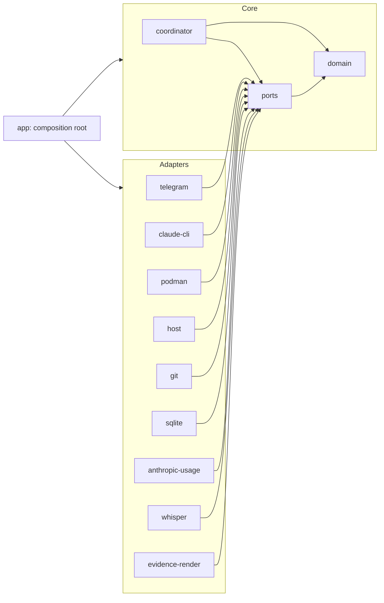
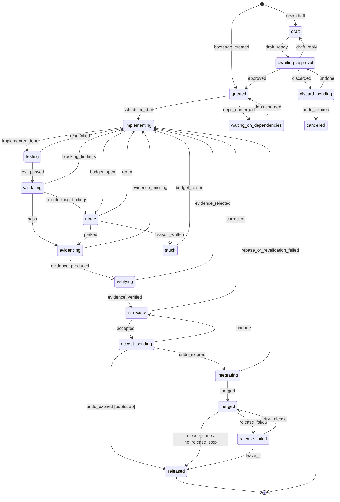
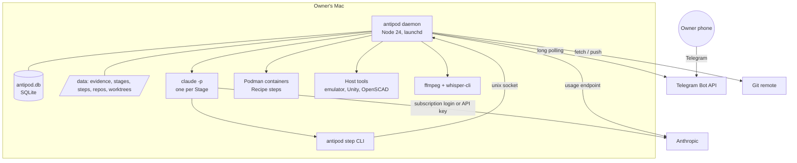
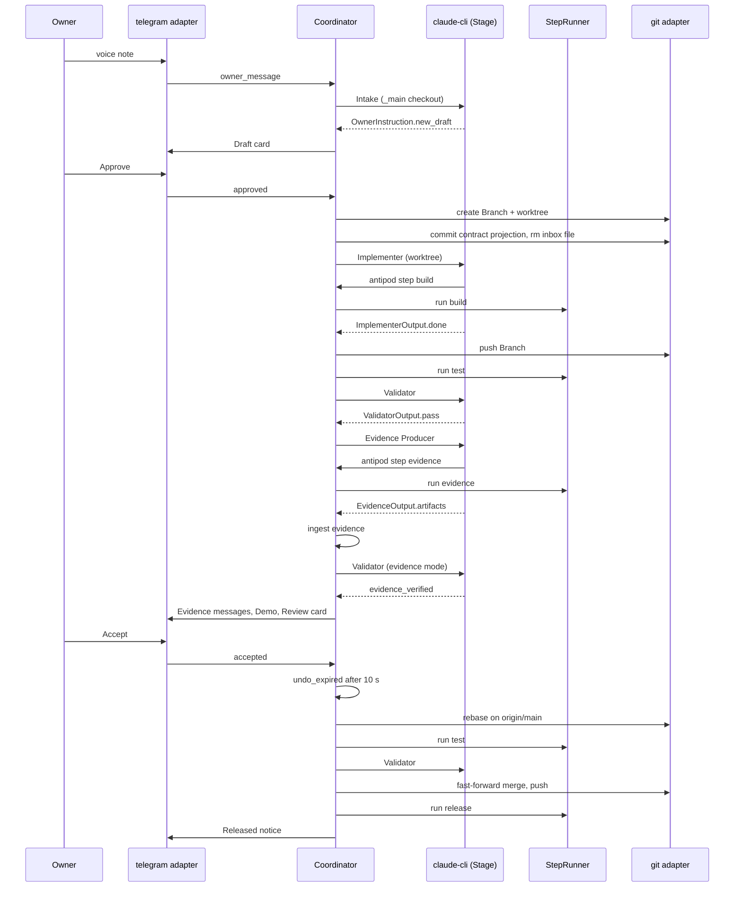
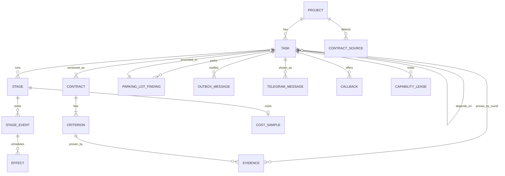

# Architecture Spine — Antipode

## Design Paradigm

**Hexagonal (ports & adapters) around a persistent finite-state-machine core.** The core is the Coordinator: a deterministic state machine over Tasks, persisted in SQLite, whose scheduler is a pure function of stored state. Everything that touches the world — Telegram, the Claude Code CLI, Podman, host tools, git, transcription, image rendering, the usage endpoint — is an adapter behind a port the core declares. Intelligence lives only in Stages; a Stage is a subprocess whose typed output is data the core turns into events.

| Layer | Directory | Contains |
| --- | --- | --- |
| Domain | `src/core/domain/` | Task, Contract, Criterion, Recipe, Evidence, Stage, Parking Lot, Cost — types, `zod` schemas, Stage output schemas, errors |
| Coordinator | `src/core/coordinator/` | `transitions.ts`, `scheduler.ts`, `effects.ts`, `recovery.ts`, `usage.ts` |
| Ports | `src/core/ports/` | `AgentRunner`, `StepRunner`, `Repo`, `Messenger`, `Store`, `EvidenceStore`, `WindowReader`, `Transcriber`, `Clock` |
| Adapters | `src/adapters/<name>/` | `telegram`, `claude-cli`, `podman`, `host`, `git`, `sqlite`, `anthropic-usage`, `whisper`, `evidence-render` |
| Composition | `src/app/` | config loading, wiring, daemon entry, `antipod` CLI, local socket server |

| Port | Implemented by |
| --- | --- |
| `AgentRunner` | `claude-cli` |
| `StepRunner` | `podman`, `host` |
| `Repo` | `git` |
| `Messenger` | `telegram` |
| `Store`, `EvidenceStore` | `sqlite` (rows) + data dir (files) |
| `WindowReader` | `anthropic-usage` (OAuth usage endpoint), with the core estimator as fallback |
| `Transcriber` | `whisper` |
| `Clock` | `app` (monotonic + wall) |



Arrows mean "may import". Nothing in `core/` imports from `adapters/` or `app/`. Adapters never import each other.

## Invariants & Rules

### AD-1 — Hexagonal core with a persistent FSM [ADOPTED]

- **Binds:** all
- **Prevents:** adapters reaching into each other or into the database directly; LLM logic leaking into the core
- **Rule:** `src/core/` has no runtime dependency outside Node built-ins and `zod`. Every external effect goes through a port declared in `src/core/ports/`. An adapter implements only the ports the table above lists for it and imports nothing from another adapter. `UsageMeter` is a core module, not a port.

### AD-2 — One process, one SQLite file as the system of record [ADOPTED]

- **Binds:** FR-11, FR-25, FR-31, NFR-2, NFR-5
- **Prevents:** two sources of truth; state held only in memory and lost on restart
- **Rule:** The `antipod` daemon is one long-running Node process under launchd. One SQLite database at `$ANTIPOD_HOME/data/antipod.db` (`ANTIPOD_HOME` defaults to `~/.antipod`) holds every durable fact: `projects`, `tasks`, `contracts`, `criteria`, `contract_sources`, `stages`, `stage_events` (append-only), `effects`, `evidence`, `parking_lot`, `cost_samples`, `usage_samples`, `capability_leases`, `telegram_messages`, `outbox`, `callbacks`, `settings`. Files (Evidence artifacts, Stage transcripts, step logs) live under `data/` and are referenced by rows; a file without a row does not exist to the system, with the single exception of a Progress Peek (AD-8).

### AD-3 — Only the Coordinator mutates Task state, commit first, act second [ADOPTED]

- **Binds:** FR-11, FR-12, FR-13, FR-14, FR-15, FR-16, FR-17, FR-27, FR-30, NFR-3
- **Prevents:** a second mutation path; a scheduler tick racing a Telegram tap; a stale Stage result advancing a Task that moved on; Owner pauses or crashes burning Iteration Budget
- **Rule:**
  - All events — scheduler ticks, Telegram commands, Stage results, step results, timeouts, SIGHUP — enter one in-process serial queue. `applyEvent(state, event)` is synchronous and runs in one SQLite transaction that writes the new Task state, the `stage_events` row and one `effects` row per effect. No adapter is called inside the transaction. An effect executor drains `effects` in insertion order after commit and marks each `done` or `failed`; effects are idempotent by `effect_id`. An effect that starts a Stage inserts the `stages` row with `status = starting` inside the transition, before any process exists.
  - Every Stage and step event carries `stage_id`. It is applied only if `stage_id = tasks.current_stage_id` and that row is `starting` or `running`; otherwise it is appended as `ignored(stale)` and does nothing. A Stage the Coordinator ends (pause, cancel, amendment, timeout) has its row set to `cancelled(<reason>)` before the signal is sent.
  - Generic events. `ACTIVE` = `queued, waiting_on_dependencies, implementing, testing, validating, triage, evidencing, verifying, in_review, integrating, stuck, paused`. `cancel → cancelled` from every non-terminal state (current Stage cancelled; Branch kept). `pause → paused` from `ACTIVE` minus `paused`, storing `tasks.resume_state` (current Stage cancelled); `resume → resume_state` with cause `resume`. `amended → implementing` from `ACTIVE` (criteria changed and confirmed; `budget_used = 0`). `stage_retries_exhausted → stuck` from any state whose current Stage is running. `deps_unsatisfiable → stuck` from `waiting_on_dependencies`. For these two direct entries to `stuck` the Coordinator writes `tasks.stuck_reason` itself; every other entry goes through Triage.
  - Undo windows: `accepted` and `discarded` store `tasks.undo_expires_at = now + limits.undo_accept_ms | limits.undo_discard_ms` (defaults 10 s, 60 s); the scheduler tick emits `undo_expired` when it has passed, and `undone` is accepted only before it. No Integration effect hangs off `accepted`.
  - Project pause: `/pause` with no Task sets `projects.paused_at`; the scheduler treats every Task of that Project as paused by the Owner.
  - Iteration Budget: `budget_used` increments only when `implementing` is entered with cause `scheduler_start` (first lap), `blocking_findings`, `rerun`, `evidence_missing`, `test_failed` or `rebase_or_revalidation_failed`. `correction`, `resume`, `retry`, `restart` and `amended` never count. `budget_spent` fires when `budget_used >= budget_limit`; `budget_raised(n)` adds `n` to `budget_limit`.
  - Usage window: the gate applies to every Stage launch, not only Task starts. A Task whose next Stage is held shows `waiting_reason = usage_window`; running Stages are never killed for the window. The "waiting for usage window" notice is sent once per `(task_id, resets_at)`.



The generic events (`cancel`, `pause`/`resume`, `amended`, `stage_retries_exhausted`, `deps_unsatisfiable`) are listed in the Rule and not drawn. `testing` is the Coordinator-run Recipe `test` step (a Recipe without a `test` step passes it at once); `verifying` is the Validator Stage in Evidence mode; both appear in `/status` as "validating".

### AD-4 — A Stage is exactly one `claude -p` subprocess with typed output and a fixed retry policy [ADOPTED]

- **Binds:** FR-12, FR-13, FR-18, FR-19, FR-28, FR-31, NFR-3, NFR-5
- **Prevents:** Roles invoking the agent differently; untyped output; a Stage outliving its timeout; retry rules differing per Role
- **Rule:**
  - The `claude-cli` adapter launches every Stage as `claude -p` with `cwd` = the Task worktree (or the Project's read-only `_main` checkout for Intake Stages, which have no Branch); `--output-format stream-json --verbose` persisted to `data/stages/<stage_id>.jsonl`; `--json-schema` = the Role's output schema exported with `z.toJSONSchema(schema, { target: "draft-7" })`; `--permission-prompts none`; `--allowedTools`, `--permission-mode`, `--mcp-config`, `--append-system-prompt-file`, `--max-turns` from the resolved Role Config. Subscription mode uses the Owner's login and no `--bare`; API-key mode (`agent.auth: api-key`) adds `--bare` and `ANTHROPIC_API_KEY`. No other flag set exists.
  - The prompt body is the Stage brief rendered from rows (AD-21): contract and criteria, Correction note, Parking Lot, `prior/index.json`, and for Intake the last `intake.context_messages` Owner and bot messages of the Task plus any unanswered question.
  - Output discriminators are fixed; full schemas live in `core/domain/stage-output/`: `ImplementerOutput.status: done | blocked`; `ValidatorOutput.verdict: pass | blocking | nonblocking` with `findings[{criterion_id, blocking, note}]`, and in Evidence mode `evidence_verdicts[{evidence_id, shows_criterion, note}]`; `TriageOutput.decision: rerun | park | stuck` with `reason`; `EvidenceOutput.artifacts[]` (AD-8); `OwnerInstruction` (AD-9). The Coordinator maps each discriminator to exactly one event.
  - A Stage fails on timeout, non-zero exit, output that does not validate, or `max_turns` exhaustion. `role.yaml` sets `timeout` and `retries` (defaults in `config.yaml`). A retry relaunches the same Stage with the same brief on the worktree as left and never consumes Iteration Budget; after `retries` failures the Coordinator emits `stage_retries_exhausted`. Timeout: SIGINT, then SIGTERM after 30 s; deadlines use monotonic time. A Stage ended by SIGTERM prints no `result`; its event is `failed(timeout)` with tokens recorded as unknown.
  - Tokens, estimated cost and duration are read from the final `result` message and returned inside the typed Stage result event. `AgentRunner.observe(stage_id)` returns `{last_text, elapsed_ms}` from the live stream for a Progress Peek.

### AD-5 — Git topology: bare clone per Project, worktree per Task, contracts arrive through an inbox [ADOPTED]

- **Binds:** FR-6, FR-9, FR-15, FR-20, FR-29
- **Prevents:** two agents sharing a tree; a merged contract re-detected forever; Antipode writing to `main` outside Integration
- **Rule:**
  - Each Project has one plain bare clone (never `--mirror`) at `data/repos/<project>.git` with refspec `+refs/heads/*:refs/remotes/origin/*`, a read-only checkout of `main` at `data/worktrees/<project>/_main/` fast-forwarded before use, and one worktree per Task at `data/worktrees/<project>/<task_no>/` on Branch `antipod/<task_no>-<slug>`. Every Stage reads any ref and writes only its own worktree.
  - The Recipe is `antipod.yaml` at the repo root. Owner-supplied contracts are files under `.antipod/inbox/<slug>.yaml` (Task Contract YAML) or `.antipod/inbox/<slug>.md` (BMad story) on `main`; they carry no number. Detection after every fetch is keyed by `(path, blob_sha)` in `contract_sources`; a pair already recorded is never offered again, and a new `blob_sha` at a path whose Task is terminal is a new draft. Files under `.antipod/tasks/` on `main` are never scanned. A story or contract without per-criterion Required Evidence enters as `draft` through Intake.
  - On approval the Coordinator assigns `task_no` and creates the Branch and worktree; nothing is committed yet. The Branch's first commit is the contract projection of AD-21, made on the first entry to `implementing`, and it also `git rm`s the inbox file the Task came from; the removal reaches `main` only at merge. Antipode commits to `main` only by fast-forward in Integration.
  - The Branch is pushed to `origin` after every Implementer Stage. Worktrees are removed after `released` or `cancelled`; Branches are kept.

### AD-6 — Stage agents run on the host; Recipe steps run only through the daemon `[ASSUMPTION]`

- **Binds:** FR-2, FR-12, FR-20, NFR-4
- **Prevents:** two agent-launch paths; a Stage shelling out to build tools and bypassing the container, secrets or leases
- **Rule:** In the MVP the `claude` process of a Stage runs on the host. A Stage invokes a Recipe step only through `antipod step <name>` on its PATH, which talks to the daemon over the Unix socket `$ANTIPOD_HOME/run/antipod.sock` and blocks until the daemon has run the step through `StepRunner`; the Stage receives the exit code, the log path and `ANTIPOD_OUT`, never the secrets or the container. Direct invocation of a Project's build, test or emulator tools by a Stage is denied by every shipped Role `permissions.json`, as are reads under `$ANTIPOD_HOME` and other Tasks' worktrees. MVP isolation (NFR-4) is therefore Claude Code permission policy plus a secret-free environment, not OS enforcement. Running the agent itself inside a container is deferred to the VM host and replaces only the `claude-cli` adapter.

### AD-7 — One step contract for both Runners, with Preview Data, prior Evidence and leases [ADOPTED]

- **Binds:** FR-2, FR-5, FR-13, FR-22, FR-29, FR-30, NFR-4
- **Prevents:** steps written for one Runner that break on the other; two ways to pass secrets or seed data; two lock owners for an exclusive host capability
- **Rule:**
  - A Recipe step is `{name, runner: container|host, cmd, image?, capability?, exclusive?, timeout, secrets: [names], outputs: dir}`. Reserved names: `build`, `test`, `evidence`, `demo`, `release`. Both Runners honour the same contract: `cwd` = the worktree; `env` = the step's named secrets plus `ANTIPOD_OUT`, `ANTIPOD_DATA`, `ANTIPOD_PRIOR`, `ANTIPOD_TASK`; `ANTIPOD_OUT` is `data/steps/<step_run_id>/out/`; the step writes only into `ANTIPOD_OUT`, `ANTIPOD_DATA` and the worktree; stdout and stderr go to `data/steps/<step_run_id>/log`. Stages receive the same `ANTIPOD_PRIOR` and `ANTIPOD_TASK` variables, and shipped Role permissions allow reads under `ANTIPOD_PRIOR` and the Stage's own step outputs. The container Runner bind-mounts the worktree and `ANTIPOD_OUT` and `ANTIPOD_DATA` read-write, `ANTIPOD_PRIOR` read-only, nothing else.
  - Preview Data: a Recipe may declare `fixtures: <dir>`; before a step runs, the Runner ensures `ANTIPOD_DATA` (`data/worktrees/<project>/<task_no>/.antipod-data/`) exists, seeded once per Task from `fixtures`; it is deleted with the worktree. Steps read seed data only from `ANTIPOD_DATA`; nothing in Antipode reads or mounts production data. The MVP Projects declare no fixtures; the key is reserved and enforced.
  - `ANTIPOD_PRIOR` holds the previous Review round's Evidence files of this Task as `prior/<evidence_id>.<ext>` plus `prior/index.json` with `{evidence_id, criterion_id, kind}`; empty in round 1.
  - Exclusive capabilities are leased in `capability_leases {capability, task_id, step_run_id, acquired_at}`. A host step naming an `exclusive` capability acquires the lease in one transaction before spawning and releases it on exit; if held by another Task the step fails fast with `capability_busy`, which the Coordinator maps to a retry after release, never to a budget unit. A capability command in `config.yaml` may reference secret names from `antipod.env` (AD-14).

### AD-8 — Evidence is immutable, criterion-linked, written by one Role; Peek is the one read of unrecorded files [ADOPTED]

- **Binds:** FR-21, FR-22, FR-23, FR-25, FR-28, NFR-1
- **Prevents:** two writers of Evidence; Evidence lost with a worktree; a Review that cannot be re-sent; a Peek that ingests half-written files
- **Rule:**
  - Only the Evidence Producer Stage creates artifacts. Its output lists `artifacts[{name, criterion_id, kind, degraded: string|null, before_of?, caption}]` with `name` relative to `ANTIPOD_OUT`. `before_of` is either an `evidence_id` from `prior/index.json` or the `name` of another artifact in the same list with `kind = screenshot`; ingest rejects the output (`evidence_missing`) otherwise. Kinds: `screenshot | screencast | render | composite | test_result | measurement | file`.
  - Ingest order: copy to `data/evidence/<project>/<task_no>/r<round>/<evidence_id>.<ext>`, `fsync`, then insert the `evidence` row inside the `evidence_produced` transaction. Rows and files are never updated or deleted; an attempt that repeats before `in_review` marks earlier rows `superseded = 1`. A file with no row after a crash is deleted at boot. Ingest rejects a video longer than 60 s or any artifact over 50 MB with `evidence_missing` and the reason.
  - The Validator reads Evidence; the Telegram adapter renders it; `/evidence` replays the rows of a round.
  - A Progress Peek reads ephemeral data and records nothing: its visual is the newest closed image or video file (mtime older than 2 s) under `ANTIPOD_OUT` of the newest step run of the current Stage, else the newest `evidence` row of the Task, else none; its status line comes from `AgentRunner.observe`.

### AD-9 — All free-text Owner input is interpreted by one Intake Stage into typed instructions [ADOPTED]

- **Binds:** FR-7, FR-8, FR-9, FR-10, FR-28, NFR-3
- **Prevents:** two interpretation paths; an LLM instruction acting without the confirmation the PRD requires
- **Rule:**
  - Intake is started by exactly three events: `owner_message` (text, or voice after transcription), `promote_finding` (carrying the Task and finding ids), and `inbox_detected` for a story file lacking per-criterion Evidence. Its output is `OwnerInstruction { instructions: [1..2], question? }` where each instruction is one of `new_draft` (goal, criteria, up to two questions) | `draft_reply` (draft id, answers, changes) | `correction` (task, note) | `amendment` (task, changes) | `cancel` (task) | `not_actionable`, at most one of each kind; `question` carries one clarifying question with optional quick answers.
  - The Coordinator applies `draft_reply`, `correction` and `not_actionable` directly. `amendment`, `cancel` and any `new_draft` that accompanies them are applied together after one Interpretation-card confirmation. A `new_draft` alone becomes a Draft card. Intake proposes Required Evidence only from the Project's `evidence_kinds`, and the Coordinator refuses `approved` while any criterion's Required Evidence is outside that set.
  - Inline-button taps are Coordinator commands and never pass through Intake; a quick-answer tap on a Draft card updates the draft row without a Stage. `parking_lot.status` changes only by `promote_finding` (→ `promoted`, the draft stores `source_finding_id`) and `dismiss_finding` (→ `dismissed`).

### AD-10 — Telegram adapter: long polling, persisted outbox, state-bound callbacks [ADOPTED]

- **Binds:** FR-1, FR-26, FR-27, FR-28, NFR-2, NFR-6
- **Prevents:** duplicate or lost messages across restarts; interleaved Reviews; a tap on an old card acting on a new round; one failed media send blocking a chat
- **Rule:**
  - One bot per instance, long polling, no public URL. The last processed `update_id` is persisted; an update at or below it is ignored. Only the Owner's Telegram user id (`owner.telegram_user_id` in `config.yaml`) is honoured; it also gates `/register`, which is the only registration path (the `antipod register` CLI calls the same code with `--chat-id`). `/register` refuses a chat that is not a supergroup or in which the bot cannot read all messages (not admin and privacy mode on), with the reason. The adapter reacts `👀` before any processing; after `intake.retries` failures it replaces the reaction with `❌` and a reply.
  - Every outbound message or edit is an `outbox` row `{chat_id, sequence, kind, payload, task_id?, target_message_id?, sent_message_id?, attempts}`; the sender drains one chat in sequence order and never starts a second Review sequence in a chat before the previous Review card is sent. After `outbox.retries` failed attempts a row is marked `failed`, skipped, and a loud delivery-failure notice is queued. `disable_notification` is set on every kind except `review_card`, `stuck_card`, `release_failed`, `onboarding_blocked`, `registration_failed`.
  - `callback_data` is `cb:<ulid>` resolving to `callbacks {command, task_id, round, expires_at?}`. A row is valid iff the Task is in the state its command expects and `round = tasks.review_round`; `expires_at` is used only by undo commands. On every entry to `in_review` the previous round's card keyboard is stripped (effect `retire_card`); a stale tap gets the "replaced" toast and a reply pointing to the current card.
  - `telegram_messages` maps `message_id → {task_id, round, kind}` for reply targeting and in-place edits. Updates whose Telegram timestamp is older than `telegram.stale_after` (default 5 min) are answered by reply instead of toast, and stale `/peek` requests are dropped.

### AD-11 — Scheduler gates in a fixed order [ADOPTED]

- **Binds:** FR-2, FR-3, FR-14, FR-15, FR-16, FR-17
- **Prevents:** gate checks scattered across adapters; a bootstrap blocked by its own gate
- **Rule:** On every tick the scheduler evaluates `queued` Tasks against gates in this order, all from the database: Owner pause (Project or Task) → usage window → global concurrency (`limits.concurrency`, 1–3, default 2, counting Tasks in `implementing`, `testing`, `validating`, `triage`, `evidencing`, `verifying` or `integrating`) → global Review Queue backpressure (`limits.open_reviews`, default 3, counting `in_review` and `accept_pending` across all Projects) → dependencies merged to `main` → Project bootstrap accepted (skipped for `kind = bootstrap`) → exclusive-capability hint (do not start a Task whose Recipe names an exclusive capability currently leased by another Project's Task; enforcement is the lease in AD-7). The failing gate is stored as `tasks.waiting_reason` for `/status`. The usage-window gate is re-evaluated before every Stage launch (AD-3).

### AD-12 — Usage and cost through one meter [ADOPTED]

- **Binds:** FR-17, FR-31
- **Prevents:** cost figures computed differently per Role; window logic in the Telegram adapter
- **Rule:** `core/coordinator/usage.ts` is the sole caller of `Store.insertCostSample` and `insertUsageSample`. Per-Stage tokens, estimated cost and wall time arrive inside the Stage result event and are recorded as an effect of it. `WindowReader.read()` returns `{five_hour: {utilization, resets_at}, weekly: {utilization, resets_at}} | null`; the `anthropic-usage` adapter calls the OAuth usage endpoint Claude Code's own `/usage` uses `[ASSUMPTION: undocumented endpoint; spike before relying on it]`, and a `null` reading falls back to the core estimator over `cost_samples`. Window share per Stage is the utilization delta sampled after the Stage `[ASSUMPTION]`, shown as `—` when unknown. The pause threshold is `usage.pause_at_percent`; the resume estimate is `resets_at`. `/cost` reads `cost_samples` grouped by Task, Project or window.

### AD-13 — Integration is rebase, test, revalidate, fast-forward; bootstrap never merges `[ASSUMPTION]`

- **Binds:** FR-3, FR-20, FR-29, FR-30
- **Prevents:** two definitions of green; merges that bypass revalidation; a no-op bootstrap reaching Release
- **Rule:**
  - The Coordinator runs the Recipe `test` step as an effect of `implementer_done` (state `testing`); failure is `test_failed` with the log. "CI on every push" in the MVP is that step plus the push after every Implementer Stage; a hosted CI may run but is not awaited.
  - On `undo_expired` the Coordinator rebases the worktree on `origin/main`, runs the `test` step and the Validator Stage, merges by fast-forward through the bare clone, pushes, and runs the `release` step if declared. A rebase conflict or failed revalidation is `rebase_or_revalidation_failed` (counts toward the budget); the Task then follows the normal path back to `in_review`. A failed `release` enters `release_failed` with `Retry release` and `Leave it`; `main` is never rolled back.
  - A bootstrap Task (`kind = bootstrap`, generated at registration with one criterion per declared Evidence kind and a brief asking for a visible no-op change) is never integrated or released: `undo_expired` takes it straight to `released`, sets `projects.bootstrap_accepted_at`, and deletes its Branch. Its first `test_failed`, `evidence_missing` or `stage_retries_exhausted` takes it to `cancelled(onboarding_blocked)` with the step log attached to the loud notice; the Project stays unbound from feature Tasks until a new `/register`.

### AD-14 — Secrets by name, values outside the repo, instance credentials separate `[ASSUMPTION]`

- **Binds:** FR-5, FR-30, NFR-4
- **Prevents:** secret values in a repo or in an agent's environment; the bot token or git credential leaking into steps
- **Rule:** Per-Project secret values live in `$ANTIPOD_HOME/secrets/<project>.env` (mode 600); instance credentials (`TELEGRAM_BOT_TOKEN`, the git deploy key `secrets/id_antipod` used via `GIT_SSH_COMMAND` only inside the `git` adapter) in `$ANTIPOD_HOME/secrets/antipod.env`. A Recipe names secrets per step and a step receives only those; names prefixed `PROD_` may be referenced only by the `release` step. Recipe validation fails on any value-looking literal (16+ characters assigned to a secret-like key) and on a `PROD_` reference outside `release`. Stage agents receive no secrets.

### AD-15 — Config and Role Config are layered directories, not code [ADOPTED]

- **Binds:** FR-18, FR-2, FR-13
- **Prevents:** Roles defined in code; per-Project settings hard-wired
- **Rule:** Settings resolve `$ANTIPOD_HOME/config.yaml` ← `antipod.yaml` (Project) ← Task Contract, later wins. A Role is a directory with `prompt.md`, `mcp.json`, `permissions.json`, `role.yaml` (`timeout`, `retries`, `max_turns`, `output_schema`); files resolve package `roles/<role>/` ← `$ANTIPOD_HOME/roles/<role>/` ← `.antipod/roles/<role>/` in the repo, file by file. The five MVP Roles ship as directories; a new directory is a new Role, usable by name from a Recipe step or transition config.

### AD-16 — Identity and labels [ADOPTED]

- **Binds:** all
- **Prevents:** id collisions across Projects; three definitions of "round"
- **Rule:** Internal ids are ULIDs. The Owner-facing Task number is per-Project sequential, assigned by the Coordinator at approval or bootstrap creation, and is what every message shows (`#12`). `AC<n>` is assigned once per criterion in contract order and never reused; a dropped criterion keeps its id with `status = dropped`. Parking Lot findings are `P<n>` per Task. `tasks.review_round` increments exactly on each entry to `in_review` and is the only round number; Evidence produced before that entry is stored under `review_round + 1`. Timestamps are ISO-8601 UTC in the database and local time in messages.

### AD-17 — Voice is transcribed locally `[ASSUMPTION]`

- **Binds:** FR-7, FR-28
- **Prevents:** voice notes leaving the machine
- **Rule:** The `whisper` adapter converts the Telegram voice file with `ffmpeg` and transcribes with `whisper.cpp` (`whisper-cli`) behind `Transcriber`. The transcript is stored with the Owner Message and passed to Intake; it is never echoed. Transcription failures follow `intake.retries` (AD-10).

### AD-18 — Crash-only recovery and sleep-aware clocks [ADOPTED]

- **Binds:** FR-11, FR-12, NFR-2, §6 laptop sleep
- **Prevents:** per-Stage resume logic; a restart or a sleeping Mac counted as a failure
- **Rule:** At boot the Coordinator marks every `stages` row in `starting` or `running` as `failed(restart)` and applies the retry policy (AD-4), then re-executes every `effects` row not `done` (a `start_stage` effect whose `stages` row is no longer `starting` is marked `done` without launching), resends unsent `outbox` rows, deletes all `capability_leases` after the host adapter has killed the processes they name, and deletes Evidence files without rows. All deadlines use monotonic time; on a wall-clock jump over 60 s, running deadlines are extended by the gap and one silent `back_online` notice is queued per affected Project. No component keeps state it cannot rebuild from the database.

### AD-19 — Nothing outside the host adapter knows the OS [ADOPTED]

- **Binds:** FR-2, §6 constraints
- **Prevents:** macOS assumptions that block the VM host
- **Rule:** Recipes reference host capabilities by name (`android-emulator`, `unity-editor`, `openscad`); `config.yaml` maps each capability to a command on this host. Only `adapters/host/` and `app/` read that map. `antipod doctor` verifies every mapped command and the daemon prerequisites (`ffmpeg`, `whisper-cli`, `podman`, `claude`, `git`).

### AD-20 — One renderer for generated imagery [ADOPTED]

- **Binds:** FR-22, DESIGN.md tokens
- **Prevents:** two implementations of before/after composites and callouts
- **Rule:** Composites and callout boxes are produced by the `antipod-evidence` CLI (`adapters/evidence-render`, `sharp`) that the Evidence Producer invokes; DESIGN.md tokens are compiled into that package, and Inter is bundled and selected through a package-local fontconfig file so labels never depend on host fonts. The Telegram adapter sends files as given and never draws.

### AD-21 — The contract row is the record; the contract file is a projection [ADOPTED]

- **Binds:** FR-6, FR-9, FR-10, FR-14, FR-19
- **Prevents:** criteria read from one place and amended in another; a Coordinator commit landing in a tree a Stage is editing
- **Rule:** `contracts` (versioned by `contract_version`) and `criteria` rows are the system of record once a Task exists; an inbox file is input only until import. The Coordinator writes `.antipod/tasks/<task_no>.yaml` from the rows only as the first effect on entering `implementing`, before the Stage is spawned, and commits it on the Branch as `antipod: contract v<version>` (the first such commit also removes the inbox file, AD-5); no other component writes that file, and shipped Role permissions deny Stages writes under `.antipod/`. Stage briefs are rendered from rows, never from the file. Budget limit and raises are columns on `tasks`, never in the file.

### AD-22 — Trust boundary: configuration is read from pinned `main`, never from a Task Branch [ADOPTED]

- **Binds:** FR-18, FR-19, NFR-4
- **Prevents:** an Implementer rewriting the Validator's permissions or adding `PROD_` secrets on its own Branch
- **Rule:** `antipod.yaml`, `.antipod/roles/`, `.antipod/inbox/` and secret names are read only from the bare clone's `main` at the commit SHA stored in `tasks.config_sha` when the Task was queued. A Branch that changes any of them takes effect only after merge, when the Recipe is validated again. The Validator never runs in the same Stage as the Implementer, and Triage always starts a fresh Stage.

### AD-23 — Operations envelope [ADOPTED]

- **Binds:** NFR-2, NFR-5, §6 constraints
- **Prevents:** a dev instance posting into the Owner's real chat; an upgrade or backup done differently per story
- **Rule:** `ANTIPOD_HOME` selects the instance; each instance has its own `config.yaml`, bot token, database and data dir, so development runs against a second bot. launchd (`com.agxmeister.antipod`, `KeepAlive`) writes stdout to `$ANTIPOD_HOME/logs/antipod.log`, rotated by size through `pino-roll`. Schema migrations in `adapters/sqlite/migrations/` are forward-only and run at boot; the daemon refuses to start if the database is newer than the code. `antipod backup` copies the database with `VACUUM INTO` and rsyncs `data/` to `backup.path`; `antipod upgrade` pulls, builds, migrates and `launchctl kickstart`s. Nothing else writes logs or touches the schema.

### AD-24 — Testing strategy [ADOPTED]

- **Binds:** all
- **Prevents:** tests that consume the Owner's subscription or post to the real bot; adapters tested against nothing
- **Rule:** Test runner is `vitest`. `core/` is tested only with in-memory fakes of every port; `transitions.ts` has a table-driven test covering every `(state, event)` pair including the generic events and stale-`stage_id` rejection. Each adapter has a contract test against its port using a fake external: a fake `claude` script on PATH emitting canned `stream-json`, a grammY transformer capturing API calls, a temporary git remote, Podman against a `busybox` image, a file-backed SQLite. No test uses the Owner's Claude login or the production bot token. One end-to-end smoke test registers `recipes/examples/openscad.yaml` and runs its bootstrap with the fake `claude`.

## Consistency Conventions

| Concern | Convention |
| --- | --- |
| Naming | TypeScript, `kebab-case` files, `PascalCase` types, `camelCase` members; SQLite tables and columns `snake_case`; events `snake_case` past-tense verbs (`implementer_done`); effects `snake_case` imperatives (`start_stage`, `retire_card`) |
| Data & formats | YAML for Recipe, contracts, config and Role Config; JSON for Stage output and MCP config; ids ULID; money USD float estimate; durations ms integers |
| Errors | Domain errors are typed classes in `core/domain/errors.ts`; an adapter maps its failures to them; a failure the Owner must see becomes an `outbox` notice, never only a log line |
| Logging | `pino`, one JSON line per event, always with `project_id`, `task_id`, `stage_id` when known; Stage transcripts and step logs are files referenced from rows |
| Config | Loaded at boot and on `SIGHUP`; validated with `zod`; a Recipe is validated on registration and on every change to `main` |
| Auth | Telegram: one Owner user id per instance; Claude: subscription login or API key per `agent.auth` |
| Messages | Telegram HTML parse mode only; copy per EXPERIENCE.md and DESIGN.md; one template module per card kind in `adapters/telegram/cards/`; captions ≤ 1024 and texts ≤ 4096 characters, truncated with `…` by the template, never by the sender; the command menu is registered with `setMyCommands` at boot |

## Stack

| Name | Version |
| --- | --- |
| Node.js | 24 LTS (24.13 installed; 26 LTS at next upgrade) |
| TypeScript | 7.0 |
| grammY (Telegram Bot API) | 1.46 |
| better-sqlite3 | 13 |
| zod | 4.6 |
| pino + pino-roll | 10 / 3 |
| sharp (image rendering) | 0.35 |
| vitest | 4 |
| Claude Code CLI | 2.1.318 installed (track latest) |
| Podman | 5.5 installed; 6.1 current |
| ffmpeg | 9.0 (Homebrew; to install) |
| whisper.cpp | 1.9 (Homebrew `whisper-cpp`; to install) |
| git | 2.47 installed |
| launchd | macOS 27 user agent |

## Structural Seed

### Container view



### One Task round



### Core entities



### Source tree

```text
antipod/
  package.json
  src/
    core/
      domain/            # entities, zod schemas, stage-output/, errors
      coordinator/       # transitions.ts, scheduler.ts, effects.ts, recovery.ts, usage.ts
      ports/             # one interface per port
    adapters/
      telegram/          # grammY bot, outbox sender, cards/, callbacks
      claude-cli/        # Stage launcher, stream-json reader, observe(), Role Config resolver
      podman/            # container StepRunner
      host/              # host StepRunner, capability map, leases
      git/               # bare clone, worktrees, rebase, ff-merge, push
      sqlite/            # Store + EvidenceStore, migrations/
      anthropic-usage/   # WindowReader
      whisper/           # Transcriber
      evidence-render/   # antipod-evidence CLI (composites, callouts, bundled Inter)
    app/                 # config, wiring, daemon entry, antipod CLI, step socket server
  roles/                 # intake/ implementer/ validator/ evidence-producer/ triage/
  recipes/examples/      # android.yaml, unity.yaml, openscad.yaml
  launchd/               # com.agxmeister.antipod.plist
$ANTIPOD_HOME/           # default ~/.antipod
  config.yaml            # owner.telegram_user_id, host capabilities, agent.auth, limits, usage, backup.path
  secrets/               # antipod.env, <project>.env, id_antipod
  roles/<role>/          # Owner-level Role Config overrides
  run/antipod.sock
  logs/antipod.log
  data/                  # antipod.db, repos/, worktrees/, evidence/, stages/, steps/
```

### Recipe shape (seed)

```yaml
name: training
evidence_kinds: [screenshot, screencast, file]
demo: { kind: file, step: demo }
fixtures: null
steps:
  build:    { runner: container, image: ghcr.io/cirruslabs/android-sdk:34, cmd: ./gradlew assembleDebug, timeout: 15m, outputs: build/outputs }
  test:     { runner: container, image: ghcr.io/cirruslabs/android-sdk:34, cmd: ./gradlew testDebug, timeout: 15m }
  evidence: { runner: host, capability: android-emulator, exclusive: true, cmd: ./scripts/evidence.sh, timeout: 10m }
  demo:     { runner: container, image: ghcr.io/cirruslabs/android-sdk:34, cmd: ./scripts/demo.sh, timeout: 15m }
  release:  { runner: container, image: ghcr.io/cirruslabs/android-sdk:34, cmd: ./scripts/release.sh, secrets: [PROD_PLAY_KEY], timeout: 15m }
```

Full examples for all three Project types live in `recipes/examples/`.

## Capability → Architecture Map

| Capability / Area | Lives in | Governed by |
| --- | --- | --- |
| FR-1–3 Registration, Recipe validation, bootstrap gate | `adapters/telegram` (`/register`), `app/` CLI, `core/domain/recipe`, `coordinator/scheduler` | AD-5, AD-10, AD-11, AD-13, AD-14, AD-22 |
| FR-4 Evidence kinds, FR-8 feasibility | `core/domain/recipe`, Intake Role, `coordinator/transitions` (approval refusal) | AD-8, AD-9 |
| FR-5 Preview Data and secrets | `adapters/podman`, `adapters/host` | AD-7, AD-14 |
| FR-6–10 Intake and Owner Messages | `adapters/git` (inbox detection), `adapters/claude-cli` (Intake), `coordinator/transitions` | AD-4, AD-5, AD-9, AD-21 |
| FR-11–17 Coordinator lifecycle | `core/coordinator/` | AD-2, AD-3, AD-11, AD-12, AD-18 |
| FR-18 Role Configs | `roles/`, `adapters/claude-cli/role-config` | AD-15, AD-22 |
| FR-19–20 Separation of duties, Branch per Task | `coordinator/transitions`, `adapters/git` | AD-3, AD-4, AD-5, AD-22 |
| FR-21–25 Evidence | `adapters/evidence-render`, `coordinator/effects` (ingest), `adapters/sqlite` | AD-7, AD-8, AD-20 |
| FR-26–28 Telegram surface, Peek, status, cost replies | `adapters/telegram/`, `AgentRunner.observe` | AD-8, AD-10, AD-16, conventions |
| FR-29–30 Integration and Release | `adapters/git`, `coordinator/effects`, StepRunner | AD-13, AD-7 |
| FR-31 Cost | `core/coordinator/usage.ts`, `adapters/anthropic-usage` | AD-12 |
| NFR-1 Review time | ingest limits, one media message per criterion | AD-8, AD-10 |
| NFR-2 Durability, NFR-5 Observability | `adapters/sqlite`, data dir, pino | AD-2, AD-18, AD-23 |
| NFR-4 Isolation | Role permissions, step contract, pinned config | AD-6, AD-7, AD-14, AD-22 |
| NFR-6 Acknowledgement | `adapters/telegram` (`👀` before work) | AD-10 |
| Operations, testing | `app/`, `launchd/`, `vitest` | AD-23, AD-24 |

## Deferred

- **Agent inside a container.** Deferred to the VM host; it replaces the `claude-cli` adapter only (AD-6).
- **Demos over 50 MB and link Demos (PRD OQ2).** MVP Demo kinds are files through Telegram (APK, STL, zipped WebGL build). Preferred direction when a Demo exceeds the cap: a self-hosted Telegram Bot API server (2 GB uploads) rather than a tunnel; preview sleep and wake come with link Demos.
- **Off-machine Evidence copies and retention policy (PRD OQ3).** `antipod backup` to a local path covers the MVP; retention is "keep everything". Revisit before the VM move.
- **Usage window reading method (PRD OQ4).** The `WindowReader` seam is fixed; the endpoint is an early spike.
- **Unity automation reliability (PRD OQ5).** Spike with the uplink MCP before the Unity Project; Role Config (AD-15) is unchanged either way.
- **Hosted CI integration.** Not awaited (AD-13).
- **Preview environments for web Projects.** No MVP Project needs one; the step contract leaves room for a `preview` step.
- **Full Stage output schemas, Stage brief templates and Role prompts.** Discriminators are fixed in AD-4; the rest is owned by `roles/` and the code.
- **Iteration Budget default, Role timeouts and retry counts.** Config values, tuned on the first Project.
- **macOS Keychain for secrets.** Revisit before the VM move (AD-14).
- **BMad story parser.** Intake maps a story to a contract; a deterministic parser is added only if Intake's mapping proves unreliable.
