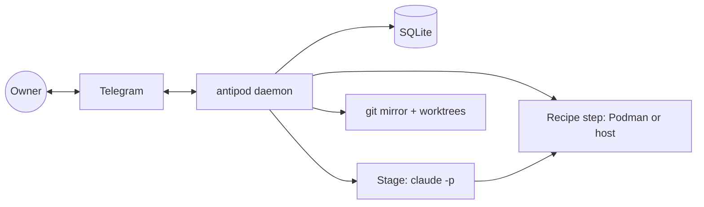

# Antipode — Solution Design

The spine (`ARCHITECTURE-SPINE.md`) is the contract agents build against. It records decisions, not reasons. This document is the reasons: how the system is shaped, what was weighed, and what was rejected. Where this document and the spine disagree, the spine wins.

## 1. The shape in one paragraph

Antipode is one Node process on the Mac, started by launchd, that owns one SQLite file. That process is a deterministic state machine over Tasks. Every time it needs intelligence it starts a fresh `claude -p` subprocess in the Task's own git worktree, gives it a Role's instructions and tools, and demands a typed JSON answer. Every time it needs to build, test, record or release, it runs a step the Project's Recipe declared, either in a Podman container or on the host. Every time it needs the Owner it writes a message into an outbox that a Telegram bot drains in order. Nothing else holds state. If the Mac restarts, the process reads the database and continues.

## 1a. What the reviewer gate changed

The first draft of the spine went through five independent reviews: a rubric walk, a version check against the web and this Mac, an adversarial attack that paired units built to the letter of each rule, and reconciliations against the PRD and the UX spine. They found real holes, and the spine was rewritten before being finalized. The ones worth knowing about:

- **Transitions commit first and act second.** The first draft said a transition was one transaction, but said nothing about the effects (spawning a Stage, sending a message) that followed. A scheduler tick could spawn a Stage while a `/pause` tap committed in between. Now every effect is a row written inside the transition and executed afterwards, all events pass through one serial queue, and every Stage result carries the id of the Stage that produced it so a killed Stage can never report into a Task that moved on.
- **The Undo window is a state.** The 10 seconds between Accept and Integration were a timer in someone's memory. They are now `accept_pending` with a persisted deadline, and no Integration effect hangs off the Accept itself.
- **A mirror clone cannot be fetched once a branch is checked out in a worktree.** Reproduced by the version reviewer on this Mac. The topology is now a plain bare clone with a normal refspec.
- **Contracts arrive through an inbox.** Numbering a contract file on `main` would have made Antipode commit to `main` outside Integration and re-detect every merged contract forever. Owner-supplied files now live under `.antipod/inbox/`, carry no number, and are moved to their numbered place by the Task's first commit.
- **The contract row is the record.** Criteria lived both in a YAML file on the Branch and in rows, with no owner for amendments. Rows now own them; the file is a projection the Coordinator writes once before each Implementer Stage.
- **Configuration is read from pinned `main`.** Without that, an Implementer could rewrite the Validator's permissions on its own branch and the next Stage of the same Task would obey it.
- **A Stage reaches Recipe steps only through `antipod step`.** The first draft drew an arrow from the agent to the Runner and said nothing about how. Now there is one command on the agent's PATH that talks to the daemon over a local socket, and direct use of build tools is denied by the Role's permissions.
- **Preview Data, retries, Peek, operations and testing** were silent or deferred and are now decided.

## 2. Why hexagonal around a state machine

Three PRD rules drive the paradigm: the Coordinator contains no LLM, only the Coordinator changes Task state, and a restart loses nothing. A state machine with a persisted transition log satisfies all three mechanically. Hexagonal ports keep the machine testable without Telegram, Claude, Podman or git present: the core is plain TypeScript that takes events and returns effects, and each adapter can be replaced in isolation. That isolation is also the migration path to the dedicated VM, where the `claude-cli` adapter may become "claude in a container" while the Coordinator does not change.

Alternatives weighed:

- **An orchestrator agent.** Rejected in the PRD. Nondeterministic and loses state on restart.
- **A workflow engine (Temporal, BullMQ).** Durable execution would give retries and timeouts for free, but adds a server, a queue and a second state store for one Owner on one laptop. A table-driven FSM in SQLite covers the MVP, and the transition log is the audit trail NFR-5 asks for.
- **Event sourcing as the primary model.** Tempting given `stage_events`, but rebuilding state from events is more machinery than one Owner needs. Current state lives in `tasks`; events are an append-only history, not the source of truth.

## 3. The Stage boundary

A Stage is "one Role, one Task, one fresh session". The spine makes that literal: one `claude -p` process, one worktree, one output schema. The reasons:

- **The PRD binds the unmodified Claude Code CLI on the Owner's subscription.** The Claude Agent SDK packages exist (TypeScript 0.3.318 today) and wrap the same harness, but the support article updated on 2026-10-07 confirms that both the SDK and `claude -p` signed in with a Claude plan draw from the subscription limits, so neither path changes the economics. The CLI subprocess keeps the container story trivial (install one binary) and keeps the API-key switch a single flag: API-key mode adds `--bare` and an environment variable; nothing else moves.
- **Typed output.** `--json-schema` makes every Stage return a validated object. The Coordinator never parses prose. Intake returns an `OwnerInstruction`, the Validator a verdict with findings, the Evidence Producer a file manifest. This is how "LLM judgment enters only through bounded Stage outputs" (NFR-3) becomes code.
- **Transcripts as logs.** `stream-json` is persisted per Stage, which gives `/log` its attachment and gives the Owner the whole session if a Stage misbehaves.
- **Timeouts.** Claude Code drops the in-progress turn on SIGTERM, so the Coordinator sends SIGINT first and SIGTERM after a grace period.

A Stage never runs a build tool itself. It calls `antipod step <name>`, a small command on its PATH that asks the daemon over a local socket to run the Recipe step, and gets back the exit code and the output directory. That is how a Stage on the host still gets containers, named secrets and exclusive-capability leases without ever seeing them.

Where the agent runs is the one assumption flagged in the spine. The addendum allowed either "its own container or a sandboxed host workdir". The MVP picks the host: the Android emulator and the Unity editor live on the host anyway, Claude Code's OAuth login inside a container is reported flaky, and the Owner's own projects on the Owner's own Mac do not need container-grade isolation yet. The cost is that an Implementer with Bash can reach the whole machine. The mitigations are the Role's permission rules and no secrets in its environment. The VM host is where this gets tightened, and the spine insists that change lands in one adapter.

## 4. Runners and the Recipe

The Recipe is the Project's declaration of how it is built, tested, evidenced, demoed and released. Each step names a Runner. The important decision is that both Runners expose the same contract: same working directory, same environment rules, same output directory, same logs. A step author writes a command and a `runner:` line; the Coordinator does the rest.

Podman's macOS VM has no nested virtualization, so the Android emulator and the Unity editor cannot run in a container here. The Host Runner exists for those. To keep the VM move possible, Recipes never name macOS paths. They name a capability (`android-emulator`, `unity-editor`, `openscad`), and the host config maps the capability to a command. On a Linux VM the same Recipe works once the config maps the capability to the Linux binary.

Exclusive capabilities (one Unity editor) are a lock in the scheduler, not a convention. The scheduler's gate order puts it last so that a Task blocked only on the editor is reported as such.

"CI on every push" is resolved as: the Recipe's `test` step, run by the Runner after every Implementer Stage, is the CI. Hosted CI can exist but is not awaited. The reason is practical: Unity and Android tests need the host or a big image, and a one-Owner factory gains little from a second runner it has to wait on. This resolves the PRD's open question 1 and is tagged as an assumption so the Owner can overrule it.

## 5. Git

One bare clone per Project, one worktree per Task, plus a read-only checkout of `main` for Stages that have no Branch yet. Worktrees give each agent its own tree with a shared object store, which keeps clones cheap and makes "every Stage can read other branches" a plain `git log origin/...`. A `--mirror` clone was the first choice and failed a reality check: git refuses to fetch into a branch that is checked out in a worktree, so `main` would stop updating after the first Task. A plain bare clone with the normal remote refspec has no such problem.

Owner-written contracts and BMad stories go into `.antipod/inbox/` on `main` without a number. When the Owner approves, the Task's first commit moves the file to its numbered place under `.antipod/tasks/`, so merging a Task also merges its contract into `main` and the repo's history shows what was asked next to what was done. Status never goes into the file, and after import the rows in the database own the criteria; the file is a projection the Coordinator rewrites before each Implementer Stage. If both were writable, the file and the database would disagree the first time something crashed between the two writes.

Integration is rebase then fast-forward. A merge commit would hide whether the Validator saw exactly what reaches `main`; after a rebase the Validator re-runs on the exact tree that will be merged.

## 6. Evidence

Evidence is the product, so it gets the strictest ownership rules: one Role creates it, the Coordinator ingests it into an immutable store, the Validator reads it, the Telegram adapter renders it. Files are copied out of the worktree into the data directory, so deleting a worktree after a merge never deletes proof. Each artifact carries its criterion id and round, which makes before/after pairs a lookup, `/evidence` a replay, and the Progress Peek "the newest artifact of the running round".

Composites and callouts are rendered by one small CLI the Evidence Producer calls, so the DESIGN.md tokens (plate colour, label font, gap) exist in exactly one package. The Telegram adapter would otherwise be tempted to "fix up" an image, and two renderers would drift.

## 7. The Telegram adapter

Three decisions matter:

- **Long polling, not webhooks.** The Mac has no public URL and the PRD wants nothing exposed. Long polling needs only outbound HTTPS.
- **A persisted outbox.** The UX spine specifies what happens when the Mac sleeps: updates are processed in order on wake and nothing is lost. An outbox row per message, drained per chat in sequence, is the simplest way to get that, and it also serialises Review sequences so two Tasks never interleave their media.
- **Opaque callbacks.** `callback_data` is 64 bytes. Every button carries a short id into a `callbacks` table that holds the command, the Task and the round, plus an expiry. A tap on an old card hits an expired row and gets the "replaced" toast, which is exactly the UX rule.

Reply targeting works because every message the bot sends is recorded with its Task and kind. A reply to any such message resolves to its Task without the Owner typing an id.

## 8. Owner input and determinism

The PRD's hardest rule is that Antipode never invents intent. The spine turns it into one pipe: every free-text or voice message becomes an Intake Stage, every Intake Stage returns one instruction from a closed set, and the Coordinator applies that instruction only after the confirmation rule the UX spine defines. Buttons bypass Intake entirely because a tap already is the confirmation. The two paths never mix: a button never spawns an Intake, and Intake never acts without the Coordinator.

## 9. Usage and cost

The subscription has a rolling 5-hour window and a weekly cap, and `claude -p` draws from them. Per-Stage figures are easy: the stream's final `result` message carries tokens and an estimated cost. The window position is not officially exposed. Claude Code's own `/usage` command calls an OAuth usage endpoint that community tools have reverse-engineered, and the API returns rate-limit headers, but neither is documented. The spine therefore fixes the seam (`UsageMeter`, `WindowReader`) and leaves the reading method to an early spike, with a local estimate as fallback. If the endpoint goes away, one adapter changes.

The API-key switch stays in reach because Max plans now include monthly API credits for exactly this use.

## 10. Secrets

Values live in a per-Project env file outside the repo, mode 600, and a step receives only the names it declares. Production-scoped names are allowed only on the `release` step, which is how NFR-4's "production credentials only to Release" is enforced rather than hoped for. Stage agents get no secrets at all; if a step needs one, the step runs through the Runner, which injects it. macOS Keychain was considered and deferred: it would tie the secrets path to macOS right before the VM move.

## 11. Operations

- **Start and stop:** launchd user agent, `KeepAlive`, logs to the data directory. `antipod` CLI for register, status, doctor and the Role Config check.
- **Recovery:** crash-only. Any Stage marked running at boot is treated as failed and retried under the normal policy. Outbox rows are resent.
- **Upgrades:** the daemon migrates the SQLite schema on boot (`adapters/sqlite/migrations/`). Claude Code is tracked at latest; the Stage launcher feature-detects via the `system/init` capabilities array rather than comparing versions.
- **Backups:** the data directory is the whole system. Time Machine covers the MVP; an off-machine copy is deferred with the Evidence retention question.
- **Host prerequisites not installed today:** `ffmpeg`, `whisper.cpp`, Android SDK and `adb`. `antipod doctor` should check the capability map before a Project registers.

## 12. What was rejected

| Option | Why not |
| --- | --- |
| Orchestrator agent | Nondeterministic, loses state; PRD rejects |
| Claude Agent SDK as the Stage runner | Same subscription economics, less transparent process boundary, harder container story; PRD binds the CLI |
| Postgres or Redis | A second server for one laptop and one Owner |
| Webhooks | No public URL; privacy constraint |
| Merge commits on Integration | Validator would not have seen the merged tree |
| Status inside the contract file | Two writers, guaranteed drift |
| macOS Keychain for secrets (MVP) | Ties the secrets path to macOS before the VM move |
| Cloud transcription | Voice notes leaving the Mac for no gain; whisper.cpp with Metal is fast enough |
| Web UI | Cut in the PRD |

## 13. Open questions carried forward

| Question | Where it lands |
| --- | --- |
| Usage window reading method (PRD Q4) | Spike before relying on it; `WindowReader` seam fixed |
| Demos over 50 MB (PRD Q2) | Deferred; preferred direction is a self-hosted Bot API server |
| Evidence retention and off-machine copies (PRD Q3) | Deferred to before the VM move |
| Unity automation reliability (PRD Q5) | Spike with the uplink MCP before the Unity Project |
| Iteration Budget default (PRD Q8) | Config value, tune on the first Project |

## 14. Reading order for the next steps

1. `ARCHITECTURE-SPINE.md` — the contract.
2. The PRD §4 — the capabilities, with the spine's capability map as the index.
3. `EXPERIENCE.md` — the Telegram behaviours the adapter must reproduce.
4. Then `bmad-create-epics-and-stories`, using the AD ids as citations in every story that touches a boundary.
